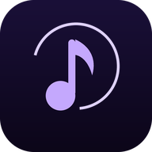

# NovaTune



A premium, free and open-source music streaming client for Android — a
modern Material 3 YouTube Music front-end with a violet AMOLED theme,
synchronized lyrics, offline caching and Android Auto support.

**NovaTune is a fork of [InnerTune](https://github.com/z-huang/InnerTune)**
by Zion Huang, openly developed by **Agastya Tomar**
([@agastyatomar](https://github.com/agastyatomar)).

[](LICENSE)


## Features

- Play songs from YouTube / YouTube Music without ads
- Background playback with a media notification and lock-screen controls
- Search songs, videos, albums, artists and playlists from YouTube Music
- Home screen with trending / newly released music (where the source permits)
- Personalized quick picks (requires login for personalization)
- Library management: songs, albums, artists, playlists, favorites
- Queue management: reorder, jump, add to next
- Cache and download songs for offline playback
- Synchronized lyrics with follow-the-song highlighting
- Audio normalization, skip silence, tempo / pitch control
- Dynamic theme, dark AMOLED (pure black) mode, violet accent
- Android Auto support
- Discord Rich Presence support

## Screenshots

| Home | Player | Library |
|:---:|:---:|:---:|
|  |  |  |

> *Placeholders — replace `docs/screenshots/*.png` with real captures.*

> **Note:** If you are in a region where YouTube Music is not available, the
> backing service is unreachable unless you route traffic through a proxy or
> VPN to a supported region (the app includes a proxy setting).

## Tech stack

- Kotlin 2.0 + Jetpack Compose (Material 3)
- Media3 / ExoPlayer for playback and background service
- Room database, DataStore preferences, Hilt dependency injection
- Coil image loading, Ktor HTTP client
- `innertube` module: unopinionated YouTube Music API wrapper (upstream InnerTune code)
- `lrclib` / `kugou`: lyrics providers, `kizzy`: Discord RPC
- `material-color-utilities`: Material You dynamic color generation

## Build

Requirements: JDK 17 (Temurin/OpenJDK 17), Android SDK with `platforms;android-35`
and `build-tools;35.0.0` (AGP downloads the rest).

```bash
# debug build (full flavor incl. Firebase hooks, needs google-services.json)
./gradlew assembleFullDebug

# release build without Firebase, no google-services.json needed (recommended)
./gradlew assembleFossRelease
# → app/build/outputs/apk/foss/release/app-foss-release.apk
```

`./gradlew` may need `sh gradlew` on filesystems that drop exec bits.
Signing: release builds are unsigned unless the following environment variables
are set (no credentials are committed to this repository):

- `AADITUNE_KEYSTORE_FILE`, `AADITUNE_KEYSTORE_PASSWORD`,
  `AADITUNE_KEY_ALIAS`, `AADITUNE_KEY_PASSWORD`

CI builds the APK automatically on every push/PR (see
`.github/workflows/android-build.yml`) and attaches release APKs on `v*` tags.

## Providers & API keys

NovaTune ships **YouTube Music (InnerTube) only** in the search UI, matching the
ReVanced-style single-source setup. Provider integrations remain in the repo
and in playback code paths (`jamendo:` / `audius:` ids still stream when queued),
but are no longer surfaced as separate filter chips or key settings.

The equivalent of ReVanced's microG login is built in: Settings > Content >
"YOUTUBE ACCOUNT" lets you paste a `music.youtube.com` login cookie and turn on
"Use login for browsing content", which powers account-based playback and
logged-in browsing exactly like official clients do (stored app-privately,
never committed).

NovaTune plays from consumer-configured sources; **no API key or other
credential is ever committed** - each key is pasted into the app
(Settings > Content) and kept in the app's private storage:

| Filter chip | Source | Needs a key? | Notes |
|---|---|---|---|
| default chips | YouTube Music (InnerTube) search | no | the app's original search |
| **YT API** | official YouTube Data API v3 search | yes - your own free key (Google Cloud console: enable "YouTube Data API v3", create an API key; restrict it to that API). Searches cost 100 quota units (~100 searches/day free). Metadata only: id/title/channel/thumbnail/duration. The Data API never provides audio streams. |
| **Free** | Jamendo (independent, CC-licensed catalogue) | yes - free client ID from dev.jamendo.com (register an app). Playback uses Jamendo's own official full-length stream URLs; CC terms apply; downloading/redistribution stays disabled in the app. |
| **Audius** | Audius open catalogue (listed in the public-apis repo) | no - zero configuration, no credential needed. Full-length streams come from the provider's own official endpoints; downloading/redistribution stays disabled in the app. |

You can also enable account-based (Google-logged-in YouTube) playback by pasting
a login cookie: sign in to music.youtube.com in any desktop browser, copy the
request header "Cookie", paste it in Settings > Content > "YouTube account
cookie". The cookie is stored in the app's private storage only.

Missing-key behavior (honest fallbacks, tested):

- "YT API" with no key: the result page shows "Add your free YouTube Data API
  key in Settings > Content..."
- "Free" with no client ID: "Free music provider not configured..."
- Quota exhaustion or an invalid key: the provider's exact message is shown;
  other providers keep working (providers fail independently).

Playback repair notes:

- Fixed the ~30-second stop: the resolver now serves cache-covered opens only
  when the cache provably covers the whole open, prefers formats whose byte
  length matches the advertised duration, and reports an honest
  "only a preview..." error instead of silently truncating.
- Live streams remain unresolvable unauthenticated - detected and auto-skipped.

## Installation

Download the latest APK from the
[Releases page](https://github.com/agastyatomar/NovaTune/releases):

- `*-foss-debug.apk` — **installable** debug build, self-signed by CI
  (auto-generated throwaway key, app id `com.agastyatomar.aaditune.debug`).
- `*-foss-release-unsigned.apk` — clean release build; unsigned, so it cannot
  be sideloaded until release signing secrets are configured in the repo.

Allow "Install unknown apps" for your file manager / browser if sideloading.
FOSS builds contain no Firebase — recommended.

## Troubleshooting

- **No sound / network error:** check regional availability; set a proxy under
  Settings → Content → Proxy.
- **Live streams:** not playable yet — YouTube requires tokens an unauthenticated
  client can't produce. NovaTune detects them, shows "Live streams aren't
  supported yet" and auto-skips to the next song.
- **App won't build:** ensure JDK **17** and `ANDROID_HOME` set; run
  `./gradlew --stop` and retry.
- **Offline songs missing:** downloads live in app-private storage;
  "Clear downloads" in Settings → Storage removes them permanently.
- **Android Auto not showing the app:** enable "Unknown sources" inside
  Android Auto developer settings.

## Contributing

See [CONTRIBUTING.md](CONTRIBUTING.md).

## Security

See [SECURITY.md](SECURITY.md).

## Attribution

- NovaTune is based on **[InnerTune](https://github.com/z-huang/InnerTune)** by Zion Huang — thank you for the excellent base! Upstream logo, UI ideas and InnerTune-era strings were replaced or rewritten for this fork.
- Influenced by [ViMusic](https://github.com/vfsfitvnm/ViMusic) (Compose music player examples).
- [KuGou](https://www.kugou.com) & [LRCLIB](https://lrclib.net) lyrics providers,
  [kizzy](https://github.com/dead8309/kizzy) Discord RPC, and Google's
  [material-color-utilities](https://github.com/material-foundation/material-color-utilities).

## Disclaimer

This project and its contents are not affiliated with, funded, authorized,
endorsed by, or in any way associated with YouTube, Google LLC, or any of its
affiliates and subsidiaries. Any trademark, service mark, trade name, or other
intellectual property rights used in this project are owned by the respective
owners.

## License

Released under the **GNU General Public License v3.0** — see [LICENSE](LICENSE).

    Copyright (C) 2023-2024  Zion Huang
    Copyright (C) 2026       Agastya Tomar

This program is free software: you can redistribute it and/or modify it under
the terms of the GNU General Public License as published by the Free Software
Foundation, either version 3 of the License, or (at your option) any later
version.
